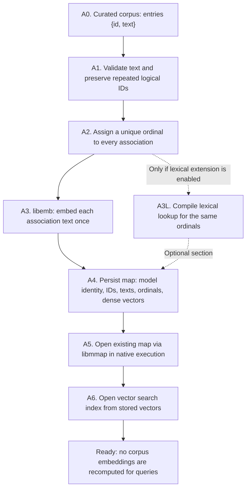
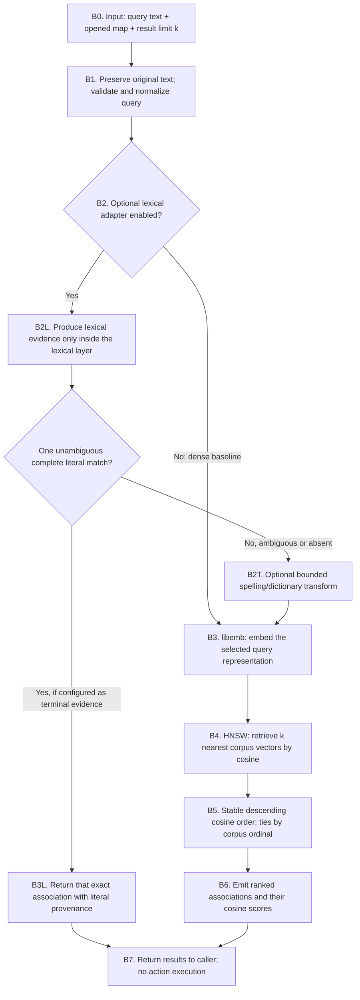
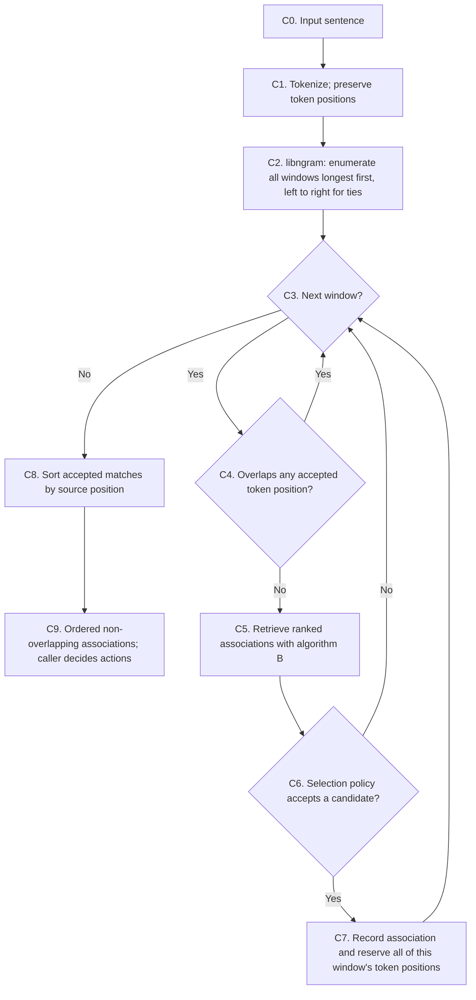

# Retrieval algorithm

## Name, scope and guarantee

The established name of the **mandatory** algorithm is **Dense Vector
Retrieval with HNSW**. Its three foundations are:

1. A **curated corpus** of independent ID/text associations.
2. **Dense embeddings** from a declared model (`libemb`).
3. **Nearest-neighbor retrieval** on those vectors (`libhnsw`, cosine).

The composition becomes **Hybrid Retrieval** only when a separately
declared lexical mechanism is enabled. Neither BM25 nor Levenshtein nor a
dictionary is part of the mandatory algorithm. The Matchplay vector-only
experiments did not use BM25.

This document is the **proposed, precise algorithm contract** for embdex.
It is not a claim that the current implementation already conforms in
every detail. The existing code is described separately in [Retrieval](retrieval.md).

**Boundary:** embdex retrieves ranked **associations**. It does not infer
an application action, choose a final intent, execute commands, or
partition a multi-command input into an orchestration plan. A separate
optional span coordinator can call the same retrieval algorithm for each
candidate span.

## A. Offline preparation — once per curated corpus

**Exact representations:**

- `Association = {ordinal, id, text, vector}`. The ordinal is unique;
  logical IDs may repeat.
- `Map = {model_identity, dimension, associations, optional_lexical_data}`.
- At build time, `vector = embed(model, text)` for each association.
- At native open time, the vector bytes are **read from the existing
  mapped artifact**. The existing V1 format does **not** persist an HNSW
  graph: the current implementation constructs that graph once at open
  for larger maps and uses direct cosine for smaller ones. This is a
  search-backend detail, not another retrieval algorithm.
- WASM access to the same portable binary is via its virtual filesystem;
  that does not imply host operating-system `mmap`.

## B. Online retrieval — exactly one query/span

The dense baseline always follows `B0 → B1 → B3 → B4 → B5 → B6 → B7`.
A lexical adapter is **not** required, and its presence is never
inferred from a dependency being available.

**The lexical boundary has a strict contract:**

- Input: one query representation plus lookup structures for the
  *same* association ordinals.
- Output: `LexicalEvidence = {ordinal, method, normalized_span,
  edit_distance?}` or a transformation with its original text
  retained. It cannot execute actions or assign an application intent.
- Complete normalized literal evidence is terminal **only when it maps
  unambiguously to one logical ID**, and only when that terminal rule
  is explicitly selected. Otherwise proceed to dense retrieval.
- Levenshtein and dictionaries are optional **bounded input
  transformations or evidence sources** inside this layer. Their
  thresholds and ambiguity behavior must be declared by the selected
  adapter; they are not silently converted into cosine similarities.
- BM25 is **not** present in the core flow. It may be investigated as
  an explicitly justified lexical adapter for problems such as
  long-document term retrieval; merely having `libbm25` as a dependency
  is not a reason to call it.
- The baseline **ranking is cosine descending**. There are no
  unexplained additive bonuses, penalties, thresholds, ranking
  fusions or ID-specific exceptions.

**Return value of the baseline**:
`RankedAssociation = {ordinal, id, text, cosine, method: "dense"}`.
An unambiguous terminal literal result has `method: "literal"` and
does not fabricate a cosine score. A result is ranking evidence,
**not** a probability of correctness. An empty or weak result must
not be interpreted as a final application decision.

## C. Optional multi-span composition — outside embdex search

Only use this outer algorithm when the caller needs **multiple commands
from a single sentence**, as in the Matchplay experiment. It is separate
from the retrieval algorithm in section B.

The **span selection policy is external to embdex**. Matchplay's
vector-only reference policy uses the highest-ranked candidate and a
declared similarity threshold. Other applications may choose another
policy; embdex must not secretly impose one. The span coordinator
preserves the following deterministic order:

1. Longer windows first.
2. Equal-length windows by earlier source position.
3. Each window invokes **one** defined retrieval contract.
4. Accepted windows reserve their positions; overlapping windows are
   ignored, not patched individually.
5. Final matches are emitted in source order.

Sentence/clause boundary recognition, context filtering and confirmation
are optional **caller-defined** policies. They are not hidden
corrections inside the embedding, HNSW, lexical or ranking layers.

## Required vs optional stages

| Stage | Mandatory? | Owner | Input → output |
| --- | --- | --- | --- |
| Curated association corpus | Yes | Corpus author | ID/text pairs → associations |
| Embeddings of corpus | Yes, at build | `libemb` | Association text → stored vector |
| Portable map and native mmap | Yes for native embdex distribution; not part of ranking | embdex / `libmmap` | Precomputed bytes → opened associations |
| Query embedding | Yes for dense path | `libemb` | Query representation → vector |
| Vector nearest-neighbor search | Yes | `libhnsw` | Query vector + stored vectors → neighbors |
| Stable cosine ranking | Yes, for dense evidence | Retrieval | Neighbors → ordered candidates |
| Exact literal evidence | No | Optional lexical adapter | Query + lexical index → literal evidence |
| Levenshtein | No | Optional lexical adapter | Query + vocabulary → spelling evidence |
| Dictionary transform | No | Optional query transform | Query → declared alternative text |
| BM25 | **No** | Optional *only if justified* | Query + term index → term evidence |
| Descending windows and overlap resolution | No, not part of single-query embdex | Caller / Matchplay | Sentence → ordered matched spans |
| Context, execution, disambiguation | No | Application | Candidates → application decisions |

## Design invariants and tests

- **One corpus, one model, one vector space.** Compare other models or
  curated corpora as separate experiments; do not encode exceptions
  for language or an output ID.
- **One role per layer.** Tokenization does not score; lexical evidence
  does not generate embeddings; HNSW does not apply application logic;
  presentation does not change ranking.
- **One shared identity.** Every method references the same association
  ordinal; duplicated logical IDs are legal and never overwritten.
- **One explicit selection policy.** Any acceptance threshold or
  conflict resolution is declared at the responsible boundary.
- **No automatic fusion.** Do not blend BM25, edit distance, literal
  evidence and cosine into an undocumented number.
- **No benchmarks as implementation patches.** Failed cases are evidence
  about the model, corpus or selected policy, not permission for
  command-specific conditions.
- **Independent validation.** Run the curated, labeled multilingual
  suites with the baseline first. Enable one optional adapter at a time
  with the same corpus, queries and model. Compare accepted IDs,
  ordering and failure cases, not only aggregate success.

## Current implementation status

The code in `src/libembdex.c` currently **differs** from this contract:

- It builds and queries BM25 indexes as part of its normal route.
- `kc_embdex_search` interleaves discovery, literal coverage,
  dictionaries, semantic retrieval and rank decisions.
- `kc_embdex_accept` contains multiple numeric acceptance conditions;
  `kc_embdex_score` combines weighted terms, cosine and extra bonuses;
  repeated logical IDs are later penalized for ranking.
- The public `kc_embdex_result_t` returns `id`, `content`, `score`,
  not the proposed explicit evidence provenance or association ordinal.

**These are observations, not approved fixes.** The diagram is a
design target for review; no claim is made that the C implementation
already follows it, and no changes to the binary format, API, ranking
or test behavior have been performed merely by documenting this design.
